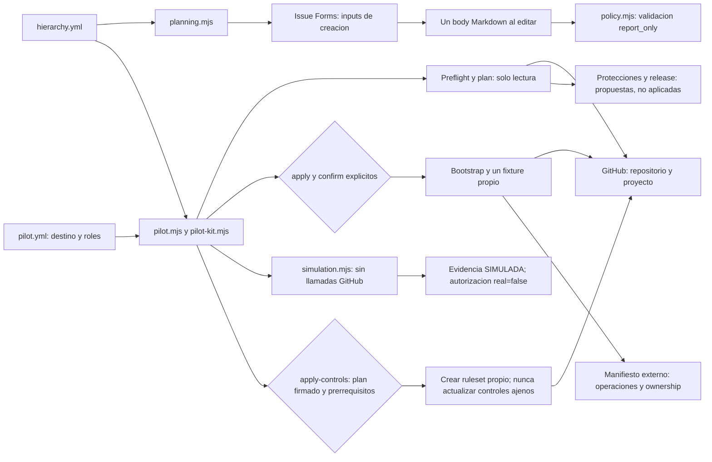
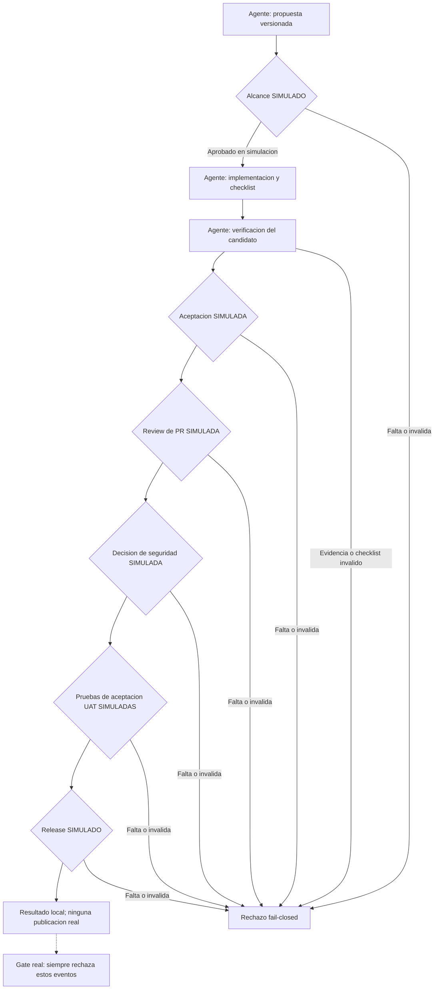

# Kit portable de colaboracion humano-agente

Este repositorio configura planificacion agil y simula una entrega completa con decisiones humanas **SIMULADAS**.
El agente actua con credenciales delegadas; el login de una cuenta no demuestra intervencion humana.
El simulador nunca concede autorizaciones reales ni publica releases.

## Componentes

| Componente | Responsabilidad |
| --- | --- |
| [Politica de planificacion](.github/planning/hierarchy.yml) | Jerarquia, tipos, campos, estados y encabezados del cuerpo de los issues. |
| [Configuracion portable](.github/planning/pilot.yml) | Destino, proyecto, identidad delegada esperada, roles ficticios y controles propuestos. |
| [Cliente y manifiesto](scripts/api.mjs) | Consultas GitHub, limites, bloqueo de escrituras en dry-run y registro externo de recursos propios. |
| [Bootstrap y fixtures](scripts/pilot-kit.mjs) | Descubrir recursos, crear solo faltantes, conservar configuracion compartida y cerrar solo el ejemplo propio. |
| [Comandos del kit](scripts/pilot.mjs) | Preflight, plan, bootstrap, fixtures, recuperacion, limpieza y simulacion. |
| [Compuertas simuladas](scripts/simulation.mjs) | Recorrido positivo y 87 negativos, ligados a alcance, commit y resumen del artefacto. |
| [Aplicacion administrativa](scripts/controls.mjs) | Crear un ruleset propio solo con plan firmado, identidad humana independiente y prerrequisitos verificados. |
| [Planificacion existente](scripts/planning.mjs) | Generar/comprobar formularios, configurar tipos/campos y ejecutar el validador manual report_only. |
| [Pruebas reproducibles](test/pilot.test.mjs) | Contrato de formularios, estados, jerarquia, compuertas, idempotencia, propiedad y fallos de acceso. |



## Ejecucion tras lift-and-shift

Instala Node.js 22 o superior y GitHub CLI. Usa una cuenta autorizada para el destino.
Cambia organizacion, repositorio, proyecto e identidad esperada en la [configuracion portable](.github/planning/pilot.yml).
No reutilices identificadores internos del origen: el kit descubre los del destino mediante sus coordenadas.
El [procedimiento operativo](SETUP.md) detalla autenticacion, permisos, plantilla de proyecto y pasos manuales.

```powershell
npm ci --ignore-scripts
npm test
npm run planning -- check-forms --dry-run
npm run pilot -- simulate
npm run pilot -- preflight
npm run pilot -- plan --dry-run
```

`simulate` funciona sin conexion a GitHub.
Sin argumentos de candidato, usa un ticket y hashes sinteticos, no una entrega existente.
`plan` muestra el destino, la linea base, los faltantes y las restricciones antes de cualquier aplicacion.
Las escrituras de bootstrap y fixtures requieren `--apply`, `--confirm organizacion/repositorio` y un manifiesto externo.
`apply-controls` permite crear un ruleset propio despues de autorizacion humana independiente y prerrequisitos verificados.
La configuracion predeterminada bloquea esa ruta: faltan identidad firmante, clave publica humana, revisores y App/check confiable.
Esta entrega no ejecuta esa aplicacion contra GitHub.

## Recorrido simulado

Cada decision incluye identificador unico, ejecucion esperada independiente, actor ficticio, fecha, caducidad y evidencia sintetica.
El consumidor registra los identificadores usados y rechaza consumirlos otra vez.
La aprobacion de alcance vincula su hash y ticket; no autoriza un candidato futuro.
Las demas etapas vinculan tambien el identificador de commit, SHA, y el resumen SHA-256 del artefacto.
SHA identifica una version; SHA-256 calcula un resumen para detectar cambios.



PR significa solicitud de cambios; UAT significa pruebas de aceptacion del usuario.
Los nombres humanos del diagrama son roles ficticios, no personas ni reviews emitidas en GitHub.
El agente genera todo el recorrido como ejercicio.
Los eventos locales son editables y no constituyen un sistema de autorizacion confiable.

## Validaciones y limites

| Superficie | Validacion efectiva | Limite |
| --- | --- | --- |
| Formularios y cuerpo | Description obligatoria; secciones duplicadas rechazadas; contenido vacio o placeholder insuficiente cuando es obligatorio. | Los inputs terminan en un unico cuerpo Markdown; no son tres campos nativos. |
| Estados | Acceptance Criteria desde Ready, incluido In progress; Delivery Evidence desde In review. | Reporta incumplimientos; no bloquea cambios de estado en Projects. |
| Jerarquia | Initiative > Epic > Feature > User Story/Bug Story > Task/issue sin tipo; terminales, ciclos y aplicabilidad de campos. | La configuracion conserva las excepciones de tipos del validador existente. |
| Simulacion | Cada gate presente, positivo, ordenado, vigente y del actor correcto; checklist completo y evidencia. | No ejecuta implementaciones, pruebas de negocio, scanners, reviews ni releases reales. |
| Invalidacion | Rechaza alcance, commit o artefacto distintos y decisiones de otra ejecucion, repetidas o de agente. | El evaluador requiere contexto de ejecucion independiente; no autentica humanos reales. |
| Bootstrap | Conflictos explicitos, recursos faltantes solamente, journal externo y verificacion posterior. | No reemplaza proyectos inaccesibles, opciones, vistas ni automatizaciones compartidas. |
| GitHub | Preflight comprueba capacidades y plan conserva su linea base. | Un archivo, checklist o comentario no acredita enforcement; hay que verificar el control efectivo. |
| Aplicacion administrativa | Plan firmado vigente, destino/estado base exactos, revisor con acceso, CODEOWNERS y check exitoso del App y SHA esperados. | Solo crea un ruleset nuevo. Rechaza controles preexistentes y no despliega identidades, checks, scanners ni release. |

Los formularios aparecen en la interfaz de creacion cuando estan publicados en la rama predeterminada.
Al editar, GitHub muestra un cuerpo con `### Description`, `### Acceptance Criteria` y `### Delivery Evidence`.
El validador usa esos mismos encabezados para formularios, agentes, interfaz de linea de comandos y API, la interfaz de programacion.
En Backlog permite criterios/evidencia ausentes o `_No response_`; desde su estado obligatorio los rechaza.

## Evidencia del piloto

El desarrollo del kit y simulador esta autorizado; las decisiones operativas humanas siguen pendientes.
La iniciativa [#21](https://github.com/RABC-SAS/bv-agile-framework/issues/21), el Epic [#22](https://github.com/RABC-SAS/bv-agile-framework/issues/22)
y las Features [#23](https://github.com/RABC-SAS/bv-agile-framework/issues/23), [#24](https://github.com/RABC-SAS/bv-agile-framework/issues/24),
[#25](https://github.com/RABC-SAS/bv-agile-framework/issues/25) y [#26](https://github.com/RABC-SAS/bv-agile-framework/issues/26) conservan esa separacion.

El ejemplo [#27](https://github.com/RABC-SAS/bv-agile-framework/issues/27) demuestra creacion con tipo y membresia en el proyecto existente.
Su repeticion no genera escrituras; la casilla de alcance humano real permanece sin marcar.
Una lectura inmediata de membresia requirio recuperacion verificada sin repetir la mutacion.
El kit limita esa espera a cuatro lecturas y registra las operaciones pendientes.

La demostracion no cambia protecciones, permisos, identidades, secretos ni configuracion de BigView.
Tampoco fusiona el [PR #3](https://github.com/RABC-SAS/bv-agile-framework/pull/3), ni crea reviews o releases reales.
Los ejemplos negativos anteriores permanecen intactos.
